# Which MLP neurons carry the base-to-instruct difference?

Instruction tuning changes what a language model writes. We asked how much of that change runs through the neurons whose explanations the registry has VERIFIED. In Qwen2.5-0.5B and its instruct model, we patched each layer's VERIFIED poles from one model into the other on 128 chat conversations. Then we measured how close the output came to the instruct model's. Wholly at its base activation, one layer raises the KL from the instruct model by a median 0.0193 nats per response token, against 0.181 for the whole base model. Inside that one layer, the VERIFIED poles close a median 0.2% of the gap, and 1.2% at most, at layer 21. As many random poles close 0.14%. So the VERIFIED poles carry about their share by number, and not the change. Their instruct activations are nonetheless specific to the prompt. The same poles' activations from another conversation make the output worse at 18 of 24 layers. The explained neurons look like parts that instruction tuning keeps, not the parts that it changes.

**Status:** Preprint. Work left: #6606 (the same test on Qwen2.5-1.5B, and on the chat template's tokens alone)

## Introduction

A neuron explanation in the registry says what a pole of an MLP neuron responds to in one model. Instruction tuning turns a base model into a chat model, and it changes the model's outputs a great deal. An earlier analysis found that most explanations survive it. In Qwen2.5-0.5B, 252 of 311 VERIFIED hypotheses still pass their probes on the instruct model (`docs/analyses/base-instruct.md`). That leaves a question. If the explained neurons keep their function, where does the change happen, and do the explained neurons carry any of it?

Minder et al. (2025) asked the same question of crosscoder latents in Gemma 2 2B. They patched the chat model's latents into the base model's activation and measured the KL divergence from the chat model. We ask it of native neuron poles, with the review's VERIFIED poles as the units. The paper bears on research question 4, *Do explanations carry across models?* ([research questions](../../docs/research-questions.md)).

The contributions are these:

1. **A measurement at every layer of Qwen2.5-0.5B** of how much of the base-to-instruct KL its VERIFIED poles carry. Two designs are used: patching into the instruct model, as Minder et al. (2025) do, and patching into the base model, as the issue asked (Tables 1 and 2). *Limit:* one pair of models, and one layer at a time.
2. **A random-pole null of the same size at each layer.** The VERIFIED poles beat it at 7 layers, fall below it at 3, and match it at the rest (Figure 1). *Limit:* five random draws per layer.
3. **The control that Prakash et al. (2024) lack:** the same poles' instruct activations from another conversation. It shows that the poles' activations carry information about the prompt, not a general shift. *Limit:* the two conversations are aligned by position.

These results do not show that the explanations are wrong. They show that the VERIFIED poles are not where instruction tuning changes Qwen2.5-0.5B's outputs.

## Related work

Minder et al. (2025) train crosscoders on Gemma 2 2B and its chat model. They add the chat decoder's part of a set of latents to the base activation at layer 13, run the rest of the chat model, and read the KL divergence from the true chat model. Replacing the activation with both crosscoders' reconstructions cuts the KL by 59% over full responses and by 78% over the first 9 tokens (`docs/literature/crosscoder-chat-tuning.md`). Our first design follows theirs, with neuron poles in place of latents and the base activation of the whole layer in place of one residual site.

Prakash et al. (2024) patch activations from a fine-tuned model into its base model to find which components carry an improvement in entity tracking. Their review notes that they report no null for this cross-model patching (`docs/literature/fine-tuning-enhances-entity-tracking.md`). So we add two: random poles, and the same poles from another prompt.

## Method

**Models.** Qwen2.5-0.5B and Qwen2.5-0.5B-Instruct (Yang et al., 2024), in float32. They share an architecture and a tokenizer, so neuron *i* of layer *l* is at the same place in both.

**Poles.** Every MLP neuron pole of Qwen2.5-0.5B whose newest record in the registry is VERIFIED, on 2026-11-24. There are 350 records, for 348 distinct poles, in all 24 layers, 10 to 25 per layer.

**Conversations.** 128 first user turns from UltraChat 200k's `test_sft` split, at commit `8049631c`, drawn with seed 0. Its card gives the MIT licence, and it cites UltraChat (Ding et al., 2023), the dataset that Minder et al. (2025) also use. For each user turn, the instruct model writes a greedy response of up to 64 tokens. Each conversation is the instruct model's chat template with the user turn and that response.

**Patching a pole.** A pole is one sign of a neuron's activation. Patching a positive pole gives the neuron the source's positive part and keeps its own negative part, and a negative pole the reverse (`hooks.replace_pole`). So the patch changes the unit that the explanation describes, and no more.

**Two designs.**

- **Into the instruct model.** The instruct model runs. At layer $l$, its MLP activation is the base model's activation for the same conversation, except the patched poles, which keep their instruct activation. With every pole patched, this is the instruct model itself. With none, the layer is wholly at its base activation, the reference. The share of that one layer's gap that the poles close is well defined.
- **Into the base model.** The base model runs, and at layer $l$ the patched poles take the instruct activation. The reference is the base model alone. Here we also patch every neuron of the layer.

**Conditions.** At each layer: the layer's VERIFIED poles, as many random poles of the same layer drawn five times without the VERIFIED ones, and the VERIFIED poles with the instruct activations of another conversation. That other conversation is the next one at least as long, and the two are aligned by position.

**The measure.** At each response token, the KL divergence from the instruct model's next-token distribution to the patched model's. It is averaged over every response token, and over response tokens 2 to 10, as Minder et al. (2025, §3.2) do over the first tokens. A condition's *share* is $1 - \overline{KL}_c / \overline{KL}_{ref}$, pooled over the conversations, with a 95% interval from 1,000 bootstrap resamples of the conversations. A random condition's share is the mean of its five draws.

The KL is computed in float32 on the device, over the response positions only. On a two-conversation trial, it matched a float64 computation to within $3 \times 10^{-7}$.

## Results



**Figure 1.** The share of the KL that patching each layer's poles removes, over every response token. Left: into the instruct model. Right: into the base model. The band is the VERIFIED poles' 95% interval. The panels' scales differ.

### Into the instruct model

| Layer | VERIFIED poles | KL with the layer at base | VERIFIED poles | Random poles | Other prompt | VERIFIED, tokens 2 to 10 |
| ---: | ---: | ---: | --- | ---: | ---: | ---: |
| 0 | 25 | 0.0066 | +0.60 (+0.37 to +0.90) | +0.13 | -14.41 | +0.76 |
| 1 | 14 | 0.0103 | +0.65 (+0.52 to +0.78) | +0.20 | -0.82 | +0.70 |
| 2 | 13 | 0.0099 | +0.70 (+0.51 to +0.90) | +0.08 | -0.21 | +0.51 |
| 3 | 13 | 0.0176 | -1.66 (-2.31 to -1.08) | +0.13 | -2.39 | -1.03 |
| 4 | 21 | 0.0179 | -0.04 (-0.22 to +0.14) | +0.13 | -0.43 | -0.03 |
| 5 | 15 | 0.0190 | +0.21 (-0.01 to +0.41) | +0.19 | -3.26 | +0.45 |
| 6 | 15 | 0.0219 | +0.20 (-0.05 to +0.45) | +0.03 | -0.90 | +0.22 |
| 7 | 10 | 0.0203 | +0.07 (-0.24 to +0.35) | +0.14 | -1.97 | +0.30 |
| 8 | 12 | 0.0267 | +0.43 (+0.17 to +0.67) | +0.30 | -0.94 | +0.77 |
| 9 | 14 | 0.0342 | -0.64 (-0.82 to -0.46) | +0.23 | -1.33 | -0.77 |
| 10 | 10 | 0.0270 | -0.24 (-0.42 to -0.07) | -0.08 | -0.95 | +0.06 |
| 11 | 11 | 0.0403 | +0.64 (+0.45 to +0.83) | +0.20 | +0.04 | +0.54 |
| 12 | 12 | 0.0316 | +0.17 (+0.02 to +0.34) | +0.20 | +0.03 | +0.07 |
| 13 | 16 | 0.0277 | +0.26 (+0.06 to +0.46) | +0.76 | -0.52 | +0.11 |
| 14 | 12 | 0.0190 | +0.27 (-0.00 to +0.52) | +0.13 | -1.02 | +0.11 |
| 15 | 12 | 0.0256 | +0.14 (+0.03 to +0.25) | +0.11 | -0.23 | +0.24 |
| 16 | 21 | 0.0209 | +0.24 (+0.08 to +0.40) | +0.35 | -1.17 | +0.21 |
| 17 | 13 | 0.0135 | +0.16 (+0.05 to +0.27) | +0.19 | -1.07 | +0.15 |
| 18 | 13 | 0.0118 | +0.10 (-0.08 to +0.25) | +0.04 | -2.08 | +0.21 |
| 19 | 13 | 0.0195 | +0.08 (-0.00 to +0.17) | +0.18 | -0.77 | +0.34 |
| 20 | 15 | 0.0167 | +0.19 (+0.07 to +0.32) | +0.14 | -2.40 | +0.28 |
| 21 | 22 | 0.0101 | +1.17 (+0.60 to +1.81) | +0.27 | -4.66 | +1.73 |
| 22 | 14 | 0.0142 | +0.25 (+0.12 to +0.37) | +0.05 | -2.53 | +0.41 |
| 23 | 12 | 0.0901 | +0.19 (+0.12 to +0.25) | +0.04 | -0.31 | +0.17 |

**Table 1.** Into the instruct model, by layer: the layer's VERIFIED poles, the mean KL with the layer wholly at its base activation (nats per response token), and the share of it that each condition closes, in percent. The VERIFIED share has its 95% interval. Random poles are the mean of five draws.

A single layer at its base activation is a small part of the whole difference. The base model's KL from the instruct model is 0.181 nats per response token. One layer at its base activation gives a median of 0.0193, from 0.0066 at layer 0 to 0.0901 at layer 23.

The VERIFIED poles close a median of 0.20% of their layer's gap, and random poles of the same number close 0.14%. A layer has $2 \times 4864 = 9728$ poles, and its VERIFIED poles are 10 to 25 of them, about 0.1% to 0.3%. So both close about their share by number. The VERIFIED poles' interval lies wholly above the random poles' interval at layers 0, 1, 2, 11, 21, 22 and 23, and wholly below it at layers 3, 9 and 13. The largest share is 1.17% at layer 21.

The other-prompt control closes a negative share at 18 of 24 layers. Giving the VERIFIED poles another conversation's instruct activations makes the output further from the instruct model than leaving them at their base activation. So the poles' activations are specific to the prompt, in both models, and the base activation is close to the instruct one.

### Into the base model

| Layer | VERIFIED poles | Random poles | Other prompt | Whole layer |
| ---: | --- | ---: | ---: | ---: |
| 0 | +0.16 (+0.11 to +0.21) | +0.04 | -0.04 | +9.46 (+6.96 to +11.60) |
| 1 | +0.01 (-0.02 to +0.05) | -0.02 | -0.05 | +10.33 (+7.38 to +13.38) |
| 2 | -0.07 (-0.12 to -0.02) | -0.05 | -0.10 | +8.57 (+6.54 to +11.01) |
| 3 | -0.01 (-0.12 to +0.08) | -0.05 | -0.12 | +4.14 (+2.54 to +5.97) |
| 4 | +0.05 (-0.05 to +0.16) | +0.03 | -0.26 | +5.41 (+3.34 to +7.47) |
| 5 | +0.01 (-0.09 to +0.11) | +0.19 | -0.36 | -3.47 (-5.15 to -1.77) |
| 6 | +0.28 (+0.11 to +0.44) | +0.00 | +0.14 | +5.10 (+2.17 to +8.10) |
| 7 | -0.06 (-0.12 to +0.00) | +0.06 | -0.40 | +0.12 (-1.99 to +2.05) |
| 8 | +0.02 (-0.08 to +0.11) | -0.03 | -0.13 | -1.57 (-3.58 to +0.28) |
| 9 | -0.14 (-0.31 to -0.02) | -0.05 | -0.16 | +0.66 (-2.38 to +3.78) |
| 10 | -0.06 (-0.14 to +0.01) | +0.03 | -0.13 | -3.69 (-5.70 to -1.77) |
| 11 | +0.07 (+0.00 to +0.13) | +0.11 | -0.07 | +0.05 (-2.14 to +2.85) |
| 12 | +0.21 (+0.13 to +0.29) | +0.06 | +0.00 | -3.18 (-5.08 to -1.23) |
| 13 | +0.12 (+0.02 to +0.22) | +0.04 | -0.07 | +6.84 (+5.33 to +8.48) |
| 14 | -0.05 (-0.12 to +0.01) | +0.01 | +0.12 | -0.42 (-2.99 to +2.51) |
| 15 | +0.09 (+0.01 to +0.16) | -0.06 | -0.03 | +11.01 (+7.93 to +13.79) |
| 16 | +0.00 (-0.04 to +0.04) | +0.01 | -0.19 | +9.60 (+8.02 to +11.10) |
| 17 | +0.04 (+0.01 to +0.06) | +0.00 | -0.07 | +8.45 (+7.20 to +9.56) |
| 18 | +0.00 (-0.02 to +0.02) | +0.01 | -0.07 | +6.92 (+5.86 to +7.94) |
| 19 | +0.02 (-0.01 to +0.05) | +0.05 | -0.08 | +13.05 (+11.33 to +15.09) |
| 20 | -0.10 (-0.17 to -0.03) | +0.03 | -0.16 | +12.51 (+10.39 to +14.75) |
| 21 | +0.05 (+0.01 to +0.11) | +0.01 | -0.32 | +1.77 (+0.88 to +2.82) |
| 22 | +0.02 (+0.00 to +0.04) | +0.01 | -0.13 | +3.43 (+2.08 to +4.63) |
| 23 | -0.01 (-0.07 to +0.03) | -0.11 | -0.14 | -33.89 (-45.18 to -23.93) |

**Table 2.** Into the base model, by layer: the share of the base model's KL that each condition removes, in percent, with 95% intervals for the VERIFIED poles and the whole layer.

With the base model downstream, the VERIFIED poles remove a median of 0.02% of the KL, and random poles 0.01%. Even the whole layer removes at most 13.1%, at layer 19. At four layers it makes the KL larger, and at layer 23 by 33.9%. The base model's later layers were not tuned to use the instruct model's activations, so this design measures less cleanly than the first one.

## Discussion

The VERIFIED poles of Qwen2.5-0.5B are not where instruction tuning changes its outputs. In the cleaner design, they close a share of their layer's gap close to what as many random poles close, and the gap of one layer is itself about a tenth of the whole. This agrees with the earlier finding that most of these explanations keep on the instruct model (`docs/analyses/base-instruct.md`). If a pole computes the same thing in both models, its base and instruct activations agree, and patching it changes little.

The other-prompt control says that the agreement is real and not an accident of small activations. A pole's activation from the wrong conversation makes the output worse, so the activations carry information that the downstream layers use. That information is the same in both models.

Minder et al. (2025) find the chat difference concentrated in a few crosscoder latents, many on the chat template's tokens. Our units are a fixed set of explained neurons, not latents chosen for being chat-specific. So the two results are not in conflict. They suggest that the change lives in directions or neurons that the registry has not explained, and the template's tokens are one place to look (#6606).

## Limitations

- **One pair of models.** Qwen2.5-0.5B only. The 1.5B pair has 74 VERIFIED poles and is not run here (#6606).
- **One layer at a time.** Each condition patches one layer. Poles in several layers might carry more of the difference together than the sum of their layers.
- **The poles are the registry's, not a sample.** VERIFIED poles were drawn by the planner and kept by a review, so they may favour stable, easy-to-explain neurons.
- **Five random draws.** The random null at each layer is the mean of five draws, so its own spread is coarse.
- **Greedy responses of up to 64 tokens.** Longer or sampled responses might move the share. The KL is read on the instruct model's own responses, as in Minder et al. (2025).
- **Position alignment.** The other-prompt control aligns two conversations by position, so its tokens differ in kind as well as in content. It shows that wrong activations hurt, not which information they lack.

## Conclusion

Patching Qwen2.5-0.5B's VERIFIED poles from one model into the other closes a share of the base-to-instruct gap about as large as their number, and as large as random poles of the same number close. The poles carry prompt-specific information that both models share. The explained neurons are what instruction tuning keeps, and its change lies elsewhere. Next, the same test on Qwen2.5-1.5B and on the chat template's tokens alone (#6606).

## References

- Ding, N., Chen, Y., Xu, B., Qin, Y., Zheng, Z., Hu, S., Liu, Z., Sun, M., & Zhou, B. (2023). *Enhancing chat language models by scaling high-quality instructional conversations*. Preprint. [arXiv:2305.14233](https://arxiv.org/abs/2305.14233).
- Minder, J., Dumas, C., Juang, C., Chughtai, B., & Nanda, N. (2025). *Overcoming sparsity artifacts in crosscoders to interpret chat-tuning*. NeurIPS 2025. [arXiv:2504.02922](https://arxiv.org/abs/2504.02922).
- Prakash, N., Rott Shaham, T., Haklay, T., Belinkov, Y., & Bau, D. (2024). *Fine-tuning enhances existing mechanisms: A case study on entity tracking*. ICLR 2024. [arXiv:2402.14811](https://arxiv.org/abs/2402.14811).
- Yang, A., Yang, B., Zhang, B., Hui, B., Zheng, B., Yu, B., Li, C., Liu, D., Huang, F., Wei, H., Lin, H., Yang, J., Tu, J., Zhang, J., Yang, J., Yang, J., Zhou, J., Lin, J., Dang, K., . . . Qiu, Z. (2024). *Qwen2.5 technical report*. Preprint. [arXiv:2412.15115](https://arxiv.org/abs/2412.15115).

## Appendices

### Reproduce

```bash
uv run python scripts/base_instruct_patch.py --out papers/instruct-difference/results.jsonl
uv run python scripts/paper_figures.py
```

It downloads both models and UltraChat 200k's `test_sft` file. It ran on an M1 Max's GPU (MPS) in about two hours, on a busy machine. The conversation draw uses seed 0, the random poles seed $1000 l + d$ for layer $l$ and draw $d$, and the bootstrap seed 0.
