# Are rank-1 LoRA directions as explainable as native neurons?

A rank-1 LoRA adds one learned direction to each matrix that it adapts, and Ward et al. (2025) read each such direction as a unit with one value per token. They report that these units are about as often monosemantic as MLP neurons, by a model's rating of their top examples. We asked whether the same units survive an adversarial audit as often as native neurons do. We trained a rank-1 LoRA on every MLP projection of Qwen2.5-0.5B, on reasoning trajectories. We audited 20 of its `down_proj` directions beside 20 random native neurons of the same model, with the same agents and the same review. The explanations of 1 of 20 adapter directions passed the review, against 12 of 20 for native neurons (Fisher's exact test, $p$ = $4.3 \times 10^{-4}$). The adapter directions failed on specificity: they are dense, and they were active on about 17 times as many tokens as the natives. The adapters also put no extra weight on the neurons whose explanations passed the review in earlier work. So in this model, a learned rank-1 direction is a dense mixture that a short explanation does not capture. We did not repeat the rating of Ward et al. (2025), but the audit suggests that a rating of top examples alone can overstate how clean such a direction is.

**Status:** Preprint. Work left: #7022 (the gate_proj and up_proj adapters, more seeds and sparse directions).

## Introduction

Low-rank adaptation fine-tunes a model by adding a product of two thin matrices to each adapted weight (Hu et al., 2022). At rank 1, each added matrix is an outer product $b a^\top$, so it reads its input along one direction $a$ and writes along one direction $b$. Ward et al. (2025) train such a LoRA on reasoning traces and treat the scalar $a \cdot x$ of each adapted matrix as a unit. They find that the units often look monosemantic and that they fire more on text that is specific to reasoning. Their judgement rests on a model that reads each unit's top 64 contexts and rates how consistent they are.

A rating of top examples is a weak test of an explanation. It sees only the strongest activations, and it does not ask whether the unit stays silent on text that resembles the explanation but should not trigger it. Oikarinen et al. (2025) find that several common metrics of neuron explanations barely change their score when an explanation's concept labels change a lot, and Heap et al. (2025) find that such metrics barely tell a trained model from a random one. Our own answer is to test each explanation with prompts that a second model writes to break it. A rank-1 direction can therefore look clean in its top examples and still fail such an audit.

Our earlier audits also give a direct baseline. Native neurons are audited by the same agents, with the same review, on the same model. A rank-1 adapter direction is a learned unit in the space of the MLP's hidden neurons, so the comparison asks whether fine-tuning finds directions that are easier or harder to explain than the basis that the model already has. Our contributions are these:

- A rank-1 LoRA on every MLP projection of Qwen2.5-0.5B, trained on the same data as Ward et al. (2025), with a held-out loss and a check that its directions moved from their random start.
- An audit of 20 of its `down_proj` directions, each as two units of opposite sign, beside 20 random native neurons, under one protocol, one set of agents and one corpus.
- A breakdown of which tests of the review each arm failed, and of how many tokens each unit is active on.
- A test of whether each adapter direction puts more of its weight on the neurons whose explanations passed the review in earlier work.

The question belongs to research question 3 of `docs/research-questions.md`, which asks whether native neurons explain a model as well as learned dictionaries do. A rank-1 adapter is a learned unit but not a dictionary, so this paper extends that question.

## Related work

**Rank-1 adapters as units.** Ward et al. (2025) adapt every projection of Qwen-2.5-32B-Instruct at rank 1 and train on the s1K-1.1 reasoning traces. They recover 73 to 90% of the benchmark gain of a full fine-tune, and they rate the monosemanticity of 448 adapter units with gpt-5-mini, against the first 60 neurons, by index, of each MLP as a baseline. Their rating reads the top 64 contexts of each unit and does not test the unit on new text (`docs/literature/rank-1-lora-reasoning-signals.md`). We keep their unit and their data, but we use a model 64 times smaller and an adversarial audit in place of the rating.

**Evaluating explanations.** Oikarinen et al. (2025) set out sanity checks for metrics of neuron explanations, and find that several common metrics fail them. Heap et al. (2025) add that automated metrics of interpretability score the units of a randomly initialised transformer almost as well as those of a trained one. Our review scores each explanation on new text: hard negatives that look like the explanation, and held-out positives that it predicts. An explanation that only describes the top examples tends to fail the hard negatives.

**Native and learned bases.** Elhage et al. (2022) call a basis privileged when the activation function breaks the rotation symmetry of a layer, and they note that a privileged basis does not guarantee that features align with it. Shabalin and Piotrowski (2026) study transcoders, dictionaries trained to stand in for the MLP (Dunefsky et al., 2024). They find that many transcoder features have encoder and decoder weights that both align with one MLP neuron, and they conclude that neurons are a stronger basis than commonly assumed. On the same model as ours, our earlier paper found that the explanations of 18 of 30 native positive poles passed the review, against 1 of 30 units of a random rotation of the same layers (`papers/native-vs-learned/`). Our own earlier audits of four sparse superposition directions of this model, found by two other methods, passed one and sent three back for revision (`docs/analyses/superposition-finders.md`). A rank-1 adapter direction is neither a neuron nor a random rotation: it is learned, but by a loss that has no reason to align it with an explainable feature. Shuttleworth et al. (2025) find that LoRA adds new high-ranking singular directions to the weights, unlike those of the pre-trained model, which suggests the same.

## Method

**Terms.** Following Cammarata (2026), we study one sign of a unit at a time and call it a *pole*: the positive part of the unit's activation, or the positive part of its negation. An explanation is one sentence that says when the pole fires. It *passes the review* when it passes every test of the adversarial review of protocol 0.10 (`docs/PROTOCOL.md`). A token is *active* when the pole's strength is at least a quarter of its maximum on the scan, and we call that level the threshold. The tests that matter here are these:

- **Specificity.** The share of hard negatives on which the pole stays below the threshold must be at least 0.80. A hard negative is a test prompt that a second model wrote to look like the explanation without meeting it.
- **Sensitivity.** The share of held-out positives on which the pole fires must be at least 0.60. A held-out positive is a test prompt that the explanation predicts will fire the pole.
- **Confound baseline.** The explanation must classify the test prompts better than the best trivial rule, such as one that uses only the prompt's length.
- **Lookahead consistency.** A claim that the pole predicts the next token must agree with a measure of its effect on the next token.

The review also checks that the pole's counterfactual pairs reproduce, that an independent model wrote the tests, and that the pole is not active on half of the scan's tokens or more. An explanation that fails some tests but not all is sent back for revision, and one that fails badly is rejected.

**The adapter.** We wrapped each of the three MLP projections of every layer of Qwen2.5-0.5B (Yang et al., 2024) in a rank-1 LoRA:

$$
W x \quad \to \quad W x + \alpha \, (a \cdot x) \, b ,
$$

where $W$ is the frozen weight, $a$ is the adapter's input direction (`lora_A`), $b$ is its output direction (`lora_B`) and $\alpha = 1$. The base model has 24 layers with 4,864 hidden neurons in each MLP, so there are 72 adapters. Each $a$ started as a random normal vector scaled by $0.01 / \sqrt{d}$, where $d$ is the input width, and each $b$ started at zero, so the adapted model began equal to the base. A small start lets the learned part of $a$ dominate its final value.

**Training.** The data was [`simplescaling/s1K-1.1`](https://huggingface.co/datasets/simplescaling/s1K-1.1) at revision `96c411f1`, whose card gives the MIT licence. Each row became one text of question, thinking trajectory and answer. We held out 50 rows by seed 5166 and trained on 950 rows, cut to 1,024 tokens each. We trained for 2 epochs with AdamW (Loshchilov & Hutter, 2019) at a learning rate of $10^{-3}$, 8 texts per step, 236 steps in all. The held-out loss fell from 1.385 to 1.130 nats per token. The median cosine of each `down_proj` direction with its random start was 0.014, so the directions we audit are learned and not their random start.

**Units.** A `down_proj` adapter reads the MLP's hidden activations $h$, the same space as the native neurons. Its direction $a$ therefore defines two poles over the hidden neurons:

$$
s_{+}(h) = \max(0,\, \hat a \cdot h), \qquad s_{-}(h) = \max(0,\, -\hat a \cdot h),
$$

with $\hat a = a / \lVert a \rVert$. Our audit tool reads such a direction as a *superposition* unit, a weighted set of neurons. We drew 20 of the 48 poles without replacement with seed 5166. The native arm drew 20 random neuron poles with seeds 5166 to 5185, each a random layer, neuron and sign. Appendix B lists every unit.

**Audit.** Every unit had one audit with the same pipeline. The scan read the first 500 documents of `NeelNanda/pile-10k`, a sample of the Pile (Gao et al., 2020). Claude Opus 5.5, the explaining model, read the scan and wrote an explanation with counterfactual pairs. Claude Sonnet 5.5, the testing model, wrote 30 test prompts, 20 hard negatives and 10 held-out positives, and then checked its labels against the prompts' real tokens. Claude Haiku 5.5 scored how well the explanation picks out the scan's active text, which the review records. The review then ran the test prompts through the model and applied the tests. The agents knew which kind of unit they audited.

**Loadings.** For each layer, we ranked the 4,864 hidden neurons by $\lvert a_i \rvert$ and read the rank of every *explained neuron*, as a percentile from 0 to 1. An explained neuron is one with a pole whose explanation passed the review in our earlier work, in the dataset of tested explanations under `wiki/`. A random set of neurons has a median percentile of about 0.5. We also compared the share of $\lVert a \rVert^2$ on the explained neurons with their share of the layer's neurons.

**Tests.** We compare the two arms' shares that passed with Fisher's exact test, and give each share's 95% Wilson interval. We compare mean specificity and mean active share with a two-sided permutation test of 20,000 relabellings, seeded. For the loadings we use an exact sign test of the layers whose median percentile is above 0.5. Figure 1 is animated so that the units appear one at a time, in layer order.

## Do adapter directions pass the review as often as native neurons?

The first question is the headline comparison: under the same audit, what share of each arm passes the review? Table 1 gives the counts, and Figure 1 shows each unit.



**Figure 1.** Each square is one audited unit, ordered by layer, with its layer under it. The upper row holds the 20 rank-1 LoRA `down_proj` poles, and the lower row the 20 random native poles. A filled square passed the review, a grey square passed some tests but not all, and a pale square failed. The squares appear one by one.

**Table 1.** The verdicts of each arm, with the share that passed and its 95% Wilson interval.

| Arm | Units | Passed | Passed some tests | Failed | Share passed |
| --- | ---: | ---: | ---: | ---: | --- |
| Rank-1 LoRA `down_proj` poles | 20 | 1 | 14 | 5 | 0.05 (0.01–0.24) |
| Random native poles | 20 | 12 | 7 | 1 | 0.60 (0.39–0.78) |

The explanations of 1 of 20 adapter poles passed, against 12 of 20 native poles, and Fisher's exact test gives $p$ = $4.3 \times 10^{-4}$. The intervals do not overlap. The native share equals the 0.60 that the earlier rotation test found for native positive poles of this model, whereas the adapter share is close to the 1 in 30 of a random rotation (`papers/native-vs-learned/`). That test differed from ours in several ways: its agents did not know the arm, it used protocol 0.8 with 20 test prompts and another scan, and its native arm held positive poles only. A rotated unit is also a dense direction over the hidden neurons, which makes the comparison apt, but the match in numbers is only suggestive. Most adapter poles did not fail outright: 14 of 20 passed some tests but not all, so a narrower explanation might fix them. The one adapter pole that passed is the positive side of layer 8.

## Which tests do the adapter directions fail?

A verdict summarises several tests, and the arms could fail for different reasons. Figure 2 places each unit by its specificity and sensitivity, and Table 2 counts the failed tests.


**Figure 2.** Each mark is one unit: its specificity, the share of hard negatives on which it stayed below the threshold, against its sensitivity, the share of held-out positives on which it fired. Triangles are adapter poles and circles are native poles. The grey lines are the two tests' limits, 0.80 and 0.60, and a unit must be right of the first and above the second to pass both.

**Table 2.** The number of units in each arm that failed each test. A unit can fail more than one test.

| Test | Adapter poles | Native poles |
| --- | ---: | ---: |
| Beats the confound baseline | 17 | 5 |
| Specificity | 18 | 2 |
| Sensitivity | 0 | 4 |
| Lookahead consistency | 1 | 1 |

The adapter poles fail on the hard negatives. Their mean specificity is 0.43, against 0.93 for the natives, lower by 0.51, with a permutation $p$ below $10^{-4}$, the floor of 20,000 relabellings. Their mean sensitivity is 0.95, higher than the natives' 0.70. The two failures go together: 17 adapter poles also failed to beat the confound baseline, because a pole that fires on most test prompts classifies them no better than a rule that ignores the explanation. The adapter explanations therefore predict the held-out positives well but do not say when the unit stays silent. The native failures are mixed. 4 natives fell short on sensitivity, which suggests an explanation that is too narrow, and 2 fell short on specificity.

## Are the adapter directions active on more of the text?

A pole that fails its hard negatives may simply be active on much of the text. The review records each unit's active share, the share of the scan's tokens at or above its threshold, and Figure 3 compares the arms.


**Figure 3.** Each mark is one unit's active share of the scan's tokens, on a log scale. The vertical bar is each arm's mean. Triangles are adapter poles and circles are native poles.

The adapter poles are active on a mean of 6.4% of the scan's tokens, against 0.39% for the native poles, about 17 times as many. The permutation test of the difference gives $p$ below $10^{-4}$, the floor of 20,000 relabellings. The ranges barely overlap: the least active adapter pole is active on 2.3% of tokens, and only 1 of the 20 native poles is active on more. No adapter pole reached the default-on limit of half the tokens, so the review audited all of them as detectors. A unit that is active on several percent of all text is hard to explain with one short rule, which fits the specificity failures above.

The density follows from the direction itself. The direction weights all 4,864 hidden neurons, so its projection mixes the contributions of many neurons, and it crosses a quarter of its maximum on more tokens than a single neuron does. Nothing requires a rank-1 adapter to be dense in this way, and #7022 will audit the same directions with all but their largest weights set to zero.

## Do the adapters favour the explained neurons?

If fine-tuning built its directions from the model's explainable neurons, the explained neurons would carry more of each $\lvert a \rvert$ than other neurons. Figure 4 shows, for each layer, the median rank of the layer's explained neurons in $\lvert a \rvert$.


**Figure 4.** For each layer, the median percentile of the layer's explained neurons in the `down_proj` adapter's $\lvert a \rvert$, from 0 for the smallest weight to 1 for the largest. A random set of neurons gives 0.5, the grey line. The mark's area grows with the number of explained neurons in the layer.

Across 24 layers and 346 explained neurons, the median of the layer medians is 0.56. 14 of 24 layers lie above 0.5, which a sign test does not separate from chance ($p$ = 0.54). The explained neurons hold 1.04 times their expected share of $\lVert a \rVert^2$. So the adapters neither favour nor avoid the explained neurons. Fine-tuning moved each direction to reduce the loss, and that direction is not built from the units that we can explain.

## Discussion

The results fit one picture. A rank-1 adapter direction in the MLP's hidden space is learned, but it is dense: it weights all 4,864 neurons, and it puts no extra weight on the neurons that have clean explanations. Its activation is therefore a mixture, and it is above its threshold on several percent of all text. An agent that reads its top examples can still write an explanation that covers them, which is why sensitivity stays high. The testing model, however, writes hard negatives that resemble the explanation, and the dense direction fires on many of them.

This picture qualifies the finding of Ward et al. (2025). We did not repeat their rating on our units. Our explaining model, however, wrote explanations that covered the held-out positives, as the high sensitivity shows, which suggests that a rating of the top examples would also look favourable. Top examples can share a theme even when the unit fires broadly. The audit adds the question that a rating does not ask: where the unit stays silent. On that question the adapter directions behave much like the random rotation of the earlier paper (`papers/native-vs-learned/`), another kind of dense direction, and much worse than the native basis. Learning a direction for a loss does not make it a direction for a feature.

Other explanations remain. Our model is 64 times smaller than theirs, and a larger model might learn sparser adapters. We trained for 2 epochs and not 5, and the directions might sharpen with longer training. The cosine with the random start was low, so the directions are not their initial noise, but they may still be far from a converged solution. The explaining model also knew that each adapter unit was a learned direction, which might change how it wrote. Finally, the native arm shares the agents' known effects: the earlier rotation test found a native share well above the overall share of our earlier random draws (`papers/native-vs-learned/`), which suggests that the agents can be generous in both arms alike.

The result bears on how learned units should be judged. Ward et al. (2025) compare their units with the first 60 neurons of each MLP, rated the same way, and report similar shares, with no interval or test. Under an audit that tests silence as well as firing, the same comparison favours the neurons by a wide margin. A rating of top examples is a useful first look, but it should not stand in for a test on new text.

## Limitations

- **One adapter.** We trained one LoRA, with one seed, for 2 epochs. Other seeds, longer training or another learning rate could give sparser directions.
- **One small model.** Qwen2.5-0.5B is far smaller than the 32B model of Ward et al. (2025). The finding may not hold at their scale.
- **Only the `down_proj` adapters.** The `gate_proj` and `up_proj` adapters read the residual stream before the MLP, which our superposition unit does not read. We did not audit them (#7022).
- **Small samples.** Each arm has about 20 units, so the shares have wide intervals. The difference is large enough to be clear, but its size is uncertain.
- **Agents not blind.** The explaining and testing models could see that an adapter unit was a learned direction. The same agents audited both arms, so the comparison holds within this agent set.
- **A dense unit under a sparse rule.** The protocol defines a superposition as a sparse set of neurons, but `lora_A` is dense. Whether a dense direction needs a unit kind of its own is a question for the maintainer, since it would change the protocol.

## Conclusion

Rank-1 LoRA directions are far less explainable than native neurons under an adversarial audit. On Qwen2.5-0.5B, the explanations of 1 of 20 adapter poles passed the review, against 12 of 20 native poles, with the same agents and the same review. The adapter directions fail because they are dense: they fire on about 17 times as many tokens as a native neuron, and so they fire on the hard negatives. They also put no extra weight on the explained neurons. This suggests that a rating of a unit's top examples alone can overstate how clean a learned rank-1 direction is. Three further studies would sharpen this answer: the `gate_proj` and `up_proj` adapters, more seeds and longer training, and an audit of the same directions made sparse (#7022).

## References

- Cammarata, N. (2026). *Neural networks are already clean*. Goodfire research essay. [already-clean.goodfire.com](https://already-clean.goodfire.com/).
- Dunefsky, J., Chlenski, P., & Nanda, N. (2024). *Transcoders find interpretable LLM feature circuits*. NeurIPS 2024. [arXiv:2406.11944](https://arxiv.org/abs/2406.11944).
- Elhage, N., Hume, T., Olsson, C., Schiefer, N., Henighan, T., Kravec, S., Hatfield-Dodds, Z., Lasenby, R., Drain, D., Chen, C., Grosse, R., McCandlish, S., Kaplan, J., Amodei, D., Wattenberg, M., & Olah, C. (2022). *Toy models of superposition*. Transformer Circuits Thread. [arXiv:2209.10652](https://arxiv.org/abs/2209.10652).
- Gao, L., Biderman, S., Black, S., Golding, L., Hoppe, T., Foster, C., Phang, J., He, H., Thite, A., Nabeshima, N., Presser, S., & Leahy, C. (2020). *The Pile: An 800GB dataset of diverse text for language modeling*. [arXiv:2101.00027](https://arxiv.org/abs/2101.00027).
- Heap, T., Lawson, T., Farnik, L., & Aitchison, L. (2025). *Automated interpretability metrics do not distinguish trained and random transformers*. Preprint. [arXiv:2501.17727](https://arxiv.org/abs/2501.17727).
- Hu, E. J., Shen, Y., Wallis, P., Allen-Zhu, Z., Li, Y., Wang, S., Wang, L., & Chen, W. (2022). *LoRA: Low-rank adaptation of large language models*. ICLR 2022. [arXiv:2106.09685](https://arxiv.org/abs/2106.09685).
- Loshchilov, I., & Hutter, F. (2019). *Decoupled weight decay regularization*. ICLR 2019. [arXiv:1711.05101](https://arxiv.org/abs/1711.05101).
- Oikarinen, T., Yan, G., & Weng, T.-W. (2025). *Evaluating neuron explanations: A unified framework with sanity checks*. ICML 2025. [arXiv:2506.05774](https://arxiv.org/abs/2506.05774).
- Shabalin, S., & Piotrowski, M. (2026). *Comparing sparsified MLPs and transcoders: Many transcoder features are neurons in disguise*. NeurIPS 2026 workshop on interpretability as a science. [arXiv:2610.24521](https://arxiv.org/abs/2610.24521).
- Shuttleworth, R., Andreas, J., Torralba, A., & Sharma, P. (2025). *LoRA vs full fine-tuning: An illusion of equivalence*. NeurIPS 2025. [arXiv:2410.21228](https://arxiv.org/abs/2410.21228).
- Ward, J., Riechers, P., & Shai, A. (2025). *Rank-1 LoRAs encode interpretable reasoning signals*. NeurIPS 2025 Mechanistic Interpretability Workshop. [arXiv:2511.06739](https://arxiv.org/abs/2511.06739).
- Yang, A., Yang, B., Zhang, B., Hui, B., Zheng, B., Yu, B., Li, C., Liu, D., Huang, F., Wei, H., Lin, H., Yang, J., Tu, J., Zhang, J., Yang, J., Yang, J., Zhou, J., Lin, J., Dang, K., . . . Qiu, Z. (2024). *Qwen2.5 technical report*. Preprint. [arXiv:2412.15115](https://arxiv.org/abs/2412.15115).

## Appendices

### A. Reproduce

Train the adapter on one GPU, write its units and loadings, audit each unit, then write the tables and figures:

```bash
uv run --with datasets==4.4.1 python scripts/lora_units.py train --device cuda
uv run python scripts/lora_units.py units
uv run open-interpretability audit --superposition papers/lora-units/units/L8-pos.json \
    --evidence-out lora-L8-pos/ev.json
uv run open-interpretability audit --model Qwen/Qwen2.5-0.5B --random --seed 5166 \
    --evidence-out native-5166/ev.json
uv run python scripts/lora_units_stats.py
uv run python scripts/paper_figures.py
```

Each audit then runs the two-step agent pipeline of `docs/experiments.md`: the proposer's hypothesis, the reviewer's probes and token check, the two judges, and `open-interpretability review`. The adapter seed is 5166, the native seeds are 5166 to 5185, and the permutation tests use seed 5166. The adapter's weights are in `adapters.safetensors`, its training record in `training.json`, and the drawn units in `units/`.

### B. Every unit

**Table 3.** Every audited unit, with its verdict, specificity, sensitivity, active share and failed tests, by the names that the review records. An adapter unit is named by its superposition id, and a native unit by its neuron and sign.

| Arm | Layer | Unit | Verdict | Specificity | Sensitivity | Active share | Failed tests |
| --- | ---: | --- | --- | ---: | ---: | ---: | --- |
| adapter | 1 | d102dab2b6e2 | failed | 0.15 | 1.00 | 5.0% | beats_confound_baseline, specificity |
| adapter | 2 | 8bd6a9b2db55 | passed some tests | 0.40 | 0.90 | 3.5% | beats_confound_baseline, specificity |
| adapter | 3 | 0e6f14a93f7d | passed some tests | 0.25 | 1.00 | 8.9% | beats_confound_baseline, specificity |
| adapter | 4 | 7a29b9302a9e | passed some tests | 0.40 | 1.00 | 9.0% | beats_confound_baseline, specificity |
| adapter | 5 | a9267eada553 | passed some tests | 0.50 | 1.00 | 9.2% | beats_confound_baseline, specificity |
| adapter | 6 | fadfaac306fe | passed some tests | 0.45 | 1.00 | 8.9% | beats_confound_baseline, specificity |
| adapter | 8 | d9c7800a5fee | passed | 0.85 | 1.00 | 5.8% | – |
| adapter | 10 | 21e866e62a9d | failed | 0.26 | 0.90 | 6.1% | beats_confound_baseline, specificity |
| adapter | 10 | 8878175dffc9 | passed some tests | 0.30 | 1.00 | 6.8% | beats_confound_baseline, specificity |
| adapter | 12 | 03b21f4c4900 | failed | 0.15 | 1.00 | 17.1% | beats_confound_baseline, specificity |
| adapter | 14 | 7e96b9d59115 | passed some tests | 0.30 | 1.00 | 5.8% | beats_confound_baseline, specificity |
| adapter | 15 | 58cea883788b | passed some tests | 0.90 | 0.80 | 2.9% | beats_confound_baseline |
| adapter | 15 | ccc4b3cc6dc7 | failed | 0.15 | 1.00 | 9.4% | beats_confound_baseline, specificity |
| adapter | 16 | e59a75646633 | passed some tests | 0.25 | 1.00 | 2.5% | beats_confound_baseline, specificity |
| adapter | 19 | f5f2782d37c7 | passed some tests | 0.60 | 0.90 | 4.2% | specificity |
| adapter | 20 | 40b72d7be3ec | passed some tests | 0.40 | 0.90 | 6.3% | beats_confound_baseline, specificity |
| adapter | 21 | 8691fa3a4a5c | failed | 0.35 | 0.80 | 5.9% | beats_confound_baseline, specificity |
| adapter | 21 | ce50b4aead65 | passed some tests | 0.65 | 1.00 | 2.3% | lookahead_consistent, specificity |
| adapter | 22 | 5b727827e901 | passed some tests | 0.45 | 1.00 | 5.7% | beats_confound_baseline, specificity |
| adapter | 23 | 76c308921c9b | passed some tests | 0.75 | 0.90 | 3.4% | beats_confound_baseline, specificity |
| native | 1 | N3869-negative | passed | 1.00 | 0.70 | 0.04% | – |
| native | 3 | N209-positive | passed | 0.85 | 0.90 | 0.19% | – |
| native | 4 | N1529-positive | passed some tests | 0.70 | 0.80 | 1.3% | specificity |
| native | 4 | N3954-positive | passed | 0.95 | 0.90 | 0.28% | – |
| native | 5 | N1494-negative | passed some tests | 1.00 | 0.30 | 0.07% | beats_confound_baseline, sensitivity |
| native | 7 | N2545-positive | passed some tests | 1.00 | 0.90 | 0.03% | lookahead_consistent |
| native | 9 | N1546-positive | passed | 1.00 | 0.80 | 0.02% | – |
| native | 9 | N2225-negative | passed some tests | 0.65 | 1.00 | 3.6% | specificity |
| native | 10 | N532-negative | passed some tests | 1.00 | 0.50 | 0.06% | beats_confound_baseline, sensitivity |
| native | 11 | N4684-positive | failed | 0.95 | 0.10 | 0.23% | beats_confound_baseline, sensitivity |
| native | 12 | N3339-negative | passed | 0.95 | 0.60 | 0.09% | – |
| native | 13 | N568-positive | passed some tests | 0.95 | 0.60 | 0.08% | beats_confound_baseline |
| native | 15 | N1011-negative | passed some tests | 0.90 | 0.40 | 0.60% | beats_confound_baseline, sensitivity |
| native | 15 | N2583-positive | passed | 0.87 | 0.80 | 0.14% | – |
| native | 16 | N1676-positive | passed | 1.00 | 0.60 | 0.03% | – |
| native | 16 | N2227-positive | passed | 0.95 | 0.90 | 0.05% | – |
| native | 18 | N1133-negative | passed | 1.00 | 0.60 | 0.09% | – |
| native | 21 | N289-negative | passed | 1.00 | 0.80 | 0.07% | – |
| native | 21 | N4807-negative | passed | 1.00 | 0.80 | 0.32% | – |
| native | 22 | N981-positive | passed | 0.90 | 1.00 | 0.47% | – |

### C. Who did the work

Claude Opus 5.5 trained the adapter, ran the audits and wrote this paper, and it proposed each explanation. Claude Sonnet 5.5 reviewed each explanation, and Claude Haiku 5.5 judged its scores. The maintainer set the question in #5166.
