# Native neurons against learned dictionaries, at equal effort

Do a model's own neurons explain it as well as a learned dictionary does? We compare them under one review protocol, one pair of agents and one audit per unit. On GPT-2 small, a transcoder latent that fires reaches VERIFIED 93% of the time, against 50% for a positive neuron pole. A third of the drawn latents never fire, and counting those, the shares are 61% against 50%. The agents read prompts of the same size in both arms, so the effort per audit was equal. Per layer, the comparison turns over. A GPT-2 layer has 24,576 latents and 3,072 positive poles. Auditing every live latent once would take about five times the audits, and would give about ten times the VERIFIED units. On Qwen2.5-0.5B, the native basis beats a random rotation of itself, 18 of 30 against 1 of 30. A decomposition of GPT-2's weights finds no basis better than the neurons. So the neurons are a privileged basis, and a learned dictionary splits them into narrower, easier units.

**Status:** Preprint. Work left: #3769 (one model, layer coverage and protocol 0.9).

## Introduction

Much interpretability work on language models does not explain the model's own neurons. It first learns a dictionary, a wider set of sparse units trained to reconstruct one layer, and then explains those units. The usual reason is that a single neuron often responds to several unrelated things, so that a short explanation of it seldom holds. A dictionary is meant to split such mixtures into narrower units. The dictionary is a second model, though, and it reconstructs the layer only in part. If a model's own neurons can be explained about as often, the case for that extra step is weaker.

Earlier comparisons leave this question open, because they measure different things. Some count how many units a task's circuit needs. Others judge whether a unit looks readable. We know of no study that puts native neurons and dictionary units through one adversarial test of their explanations, with the same agents and the same effort for each unit. A fair comparison must also count a whole layer, because a dictionary has many more units than the layer has neurons.

This paper makes that comparison on GPT-2 small (Radford et al., 2019). We study each neuron one sign at a time, and call one sign of a neuron a *pole*. We compare random positive poles with random latents of a transcoder, a dictionary trained to stand in for the MLP (Dunefsky et al., 2024). An explanation of either kind of unit is *VERIFIED* when it survives an adversarial review, in which a second model writes probes meant to break it. We then ask whether the native basis is special at all. One test audits a random rotation of the neurons of Qwen2.5-0.5B, and another decomposes GPT-2's weights with no basis given in advance.

The question is research question 3, *Do native neurons explain a model as well as learned dictionaries do?* ([research questions](../../docs/research-questions.md)).

The paper's contributions are these:

- A comparison of 40 transcoder latents that fire and 40 positive neuron poles of GPT-2 small, under one review protocol, one agent pair and one audit per unit.
- A record of the effort per audit in each arm, measured as the size of each agent's prompt.
- An extrapolation of the per-unit shares to a whole layer. It shows that the comparison turns over when the cost and the yield of a layer are counted.
- Two tests of whether the native basis is privileged: a random-rotation null on Qwen2.5-0.5B, and a parameter decomposition of GPT-2 small.

## Related work

**Superposition and dictionaries.** Elhage et al. (2022) show in toy models that a network can store more features than it has dimensions, which they call superposition. In their models, superposition gives polysemantic neurons. They write that in large language models "it actually seems rare for neurons to correspond to clean features". That view motivates learned dictionaries. Dunefsky et al. (2024) train transcoders, wide and sparse MLPs, "to faithfully approximate the original narrower MLP sublayer’s output" (§1), and they read circuits through the transcoders' latents. Marks et al. (2025) build circuits from the features of sparse autoencoders, in place of what they call "polysemantic and difficult-to-interpret units" such as neurons. For their editing method, they judge that "essentially none of the neurons are interpretable". We do not repeat their test. We instead give a written explanation of each kind of unit the same adversarial review, and count how often it survives.

**The case for the neuron basis.** Recent work finds more structure in neurons than that view expects. Arora et al. (2026) find that circuits are sparse in the neuron basis. On Llama 3.1 8B, a circuit of MLP neurons is about 100 times smaller than a circuit of MLP outputs at the same faithfulness. They call neurons "as sparse a feature basis as SAEs". Shabalin and Piotrowski (2026) split each gated neuron by the sign of its activation, as our poles do. They find that many transcoder features are neuron features, whose encoder and decoder both align with one neuron. Only those features match the MLP in the same way across training runs. They conclude that neurons are "a stronger basis for interpretability than commonly assumed". Tigges et al. (2026) also read each pole apart, on a large mixture-of-experts model. They report that a pole's positive and negative values "usually (but not always)" have unrelated roles. In their count, 69% of poles have one mode that causes at least 90% of the KL damage when the pole is ablated. We measure a different quantity from these studies: how often a unit gets an explanation that survives review.

**Privileged bases and parameter decomposition.** Elhage et al. (2022) call a basis privileged when an activation function breaks the rotation symmetry of a layer. They also note that "having a privileged basis doesn't guarantee that features will be basis-aligned". A random rotation of a layer's neurons is therefore a direct null for the native basis. Arora et al. (2026) do not compare the neuron basis with such a rotation, and we run one. Stochastic Parameter Decomposition (Bushnaq et al., 2025) gives a second test. It splits each weight matrix into rank-one subcomponents that sum to the matrix. If it found the neurons from a random start, the neurons would be special to the weights themselves, and not only to the reader.

## Method

**Units.** A neuron in a transformer's MLP can carry one meaning when its activation is strongly positive and another when it is strongly negative. We study one side at a time, and call it a *pole*. We write L3/N47+ for the positive pole of neuron 47 in layer 3. A *transcoder latent* is one hidden unit of a transcoder. A transcoder is a wide MLP with sparse ReLU units, trained to give the original MLP's output from the original MLP's input (Dunefsky et al., 2024). We write L9/F6460 for latent 6460 in layer 9. Below, a *unit* is a pole or a latent.

**The audit and the review.** Each unit gets one *audit*. A proposer agent reads the unit's strongest examples on a scan of text, and writes an explanation. The explanation is a sentence that says on which text the unit fires. A reviewer agent then writes probes meant to break the explanation, without access to the unit's activations. *Hard negatives* are near misses that the explanation says should not fire the unit. *Holdouts* are new texts that it says should fire the unit. A probe fires the unit when the unit's peak on it reaches 0.25 of the unit's maximum, which we call the *activation line*. *Specificity* is the share of hard negatives that stay below the line, and *sensitivity* is the share of holdouts that reach it. The *balanced accuracy* of an explanation is the mean of its sensitivity and its specificity.

**Gates and verdicts.** The review's *gates* are the tests that an explanation must pass. The main gates ask for a specificity of at least 0.80 and a sensitivity of at least 0.60, with enough hard negatives and holdouts. Other gates ask that the proposer's predicted counterfactual pairs reproduce on the model, and that the explanation beats a baseline of token identity. A further gate compares any claim that the unit anticipates the next token with a measured profile. An explanation is *VERIFIED* when every gate passes.

**Dead draws.** Units are drawn at random by layer and index. A *dead draw* is a unit that never fires on the scan. It has no strongest examples, so it cannot be audited.

**Shares and tests.** For $k$ VERIFIED units out of $n$, the share is $\hat{p} = k/n$. We give each share a 95% Wilson score interval. With $z = 1.96$, it is

$$
\frac{\hat{p} + \frac{z^2}{2n}}{1 + \frac{z^2}{n}} \pm \frac{z}{1 + \frac{z^2}{n}} \sqrt{\frac{\hat{p}(1 - \hat{p})}{n} + \frac{z^2}{4n^2}}
$$

We compare two independent arms with the two-sided Fisher exact test on their $2 \times 2$ table. We compare paired arms with the two-sided sign test on the pairs whose verdicts differ. The p-values are those of the source analyses.

**Setup of the dictionary comparison.**

- **Model.** GPT-2 small (Radford et al., 2019), with 12 layers and 3,072 neurons in each MLP.
- **Dictionary.** The transcoders of Dunefsky et al. (2024), repackaged as [`jacobdunefsky/gpt2small-transcoders`](https://huggingface.co/jacobdunefsky/gpt2small-transcoders) at revision `8f254a3a`. They have 24,576 latents per layer, which we read from the weights. On the scanned layers, the transcoders explained 70% of the MLP output's variance, with a mean of 54 active latents per token. The model card names no licence and no citation, only the paper.
- **Draws.** Latents were drawn uniformly by `open-interpretability audit --random --dictionary gpt2-small-transcoders`, seeds 1–61, until 40 fired on the scan. Positive poles were drawn by `--random --pole positive`, seeds 1–40. No seed was skipped, and none was audited twice. The draws and verdicts are in [`transcoder-baseline.jsonl`](../../docs/analyses/transcoder-baseline.jsonl). [The baseline write-up](../../docs/analyses/transcoder-baseline.md) gives the setup in full.
- **Positive poles only.** GPT-2's negative poles cannot pass this protocol, because most of them are default-on: they sit above the activation line on most tokens.
- **Scan.** Every scan read the same 200,000-token sample of the corpus, in 128-token windows with a stride of 64, because the transcoders fit no longer context.
- **Review.** Protocol 0.7, the same in both arms. The proposer was Claude Opus 5.5, the reviewer Claude Sonnet 5.5 and the judges Claude Haiku 5.5. Before each review, we compared the probe labels with the submitted explanation, the activation line and GPT-2's token splits. A label that contradicted the explanation went back to the reviewer that wrote it.
- **Effort.** Each record keeps the size of every agent's prompt in its provenance (`costs.llm_calls`). `scripts/native_vs_learned.py` takes the median of each arm.

**Setup of the basis tests.**

- **Rotation null.** It is in [`null-calibration.md`](../../docs/analyses/null-calibration.md). 30 units of [Qwen2.5-0.5B](https://huggingface.co/Qwen/Qwen2.5-0.5B) were drawn at random, from 20 distinct layers. Each was audited twice: as a native positive pole, and as a unit of a random rotation of the same layer. The rotation is a Haar-random orthogonal matrix, seeded per layer. A rotated unit's strength is the positive part of the projection of the MLP's hidden activations onto one rotated direction. The same agents audited both arms, Claude Opus 5.5 proposing and Claude Sonnet 5.5 reviewing with 20 probes. The arms were hidden from them. Each scan read 200,000 tokens in 512-token windows.
- **Parameter decomposition.** It is in [the SPD baseline](../../docs/analyses/spd-baseline.md) and [the SPD paper](../spd-input-projections/README.md). SPD gives each subcomponent a causal importance $g \in [0, 1]$ on each token, which says how far the subcomponent can be ablated there. Each site has $C = 3{,}072$ subcomponents, as many as the neurons. Each run trained for 50,000 steps on a Colab A100, with one seed per start.

**Figures.** Figure 1 moves. It reveals the arms one at a time, so that a reader meets each share before the next.

## Per unit, how often does each basis verify?

The first question is how often one audit of a random unit ends VERIFIED, in each basis. If neurons were as easy to explain as transcoder latents, the two shares would be close. They are not. Among the latents that fire, 37 of 40 reach VERIFIED, a share of 0.93 (95% CI 0.80–0.97). Among the positive poles, 20 of 40 do, a share of 0.50 (0.35–0.65). The difference is significant (Fisher $p = 4.3 \times 10^{-5}$). Table 1 gives every arm, and Figure 1 shows the same shares with their intervals.

**Figure 1.** The share of units that reach VERIFIED in each arm, with its 95% Wilson interval. The upper three rows are GPT-2 small: transcoder latents that fire, the same latents with dead draws counted as failures, and positive neuron poles. The lower two rows are Qwen2.5-0.5B: native positive poles, and units of a random rotation of the same layers. Each unit had one audit, with one agent pair and one protocol in each model. The arms appear one at a time.

| Arm | Model | VERIFIED | Share (95% CI) |
| --- | --- | --- | --- |
| Transcoder latents that fire | GPT-2 small | 37 of 40 | 0.93 (0.80–0.97) |
| Transcoder latents, dead draws counted | GPT-2 small | 37 of 61 | 0.61 (0.48–0.72) |
| Positive neuron poles | GPT-2 small | 20 of 40 | 0.50 (0.35–0.65) |
| Native positive poles | Qwen2.5-0.5B | 18 of 30 | 0.60 (0.42–0.75) |
| The same layers, rotated at random | Qwen2.5-0.5B | 1 of 30 | 0.03 (0.01–0.17) |

**Table 1.** The share of units that reach VERIFIED, by arm. A dead draw is a latent that never fires on the scan, and the second row counts each one as not VERIFIED. The Qwen2.5-0.5B rows are the rotation null of the last experiment.

The comparison above is among units that fire. 21 of the 61 latent draws never fired on the scan, and no neuron draw was dead. Over the scanned layers, the drawn latents' scans put the dictionary's dead share at 29% on average. When each dead draw counts as a failure, the latents reach VERIFIED 37 of 61 times, a share of 0.61 (0.48–0.72). That is still above the poles' 0.50, but the gap is no longer significant ($p = 0.31$). So the advantage per unit belongs to the latents that fire, and about a third of the drawn latents do not fire on 200,000 tokens.

A VERIFIED pole is about as sharp as a VERIFIED latent. The mean balanced accuracy is 0.90 for the poles and 0.95 for the latents. Most poles that failed still scored between 0.75 and 0.86. The two arms differ in how they fail. Most latents got narrow lexical or syntactic explanations, such as a detector of one token, and none failed on specificity. Of the 20 poles that failed, 13 failed on specificity. Their explanations described a family, and the reviewer found members of the family outside it. Six more failed because the explanation stated a floor that every prompt clears, so the reviewer could write no hard negative. The appendix *How each arm failed* gives each failure. The gap is thus in how often a neuron has one narrow meaning, not in how well a good explanation fits.

## Was the effort per audit equal?

A higher share per unit means little if one arm received more effort. The second question is whether the agents had the same input in both arms. Their token counts were not recorded, but each record keeps the size of every prompt. We use the median prompt size per arm as the measure of effort (Table 2).

| Arm | Proposer prompt (median characters) | Reviewer prompt | Audits |
| --- | --- | --- | --- |
| Transcoder latents | 17,417 | 8,239 | 40 |
| Positive neuron poles | 17,877 | 9,392 | 40 |

**Table 2.** The median size of each agent's prompt, in characters, by arm. Each unit had exactly one audit, by the same proposer and reviewer.

The proposer's prompts differ by about 3% between the arms, and the reviewer's by 14%. In both cases the poles' prompts are the larger, and no unit had a follow-up audit. The higher share of the latents does not come from more effort per audit.

## What would a whole layer cost and give?

A share per unit does not settle the choice of basis, because the two bases have different numbers of units. A GPT-2 layer has 24,576 latents and 3,072 positive poles, eight latents for each neuron. The third question is what an audit of every live unit in one layer would cost, and how many VERIFIED units it would give. Let $N$ be the units per layer, $f$ the share of units that fire on the scan, and $s$ the share of live units that reach VERIFIED. Then the audits and the expected VERIFIED units are

$$
A = N f, \qquad V = A s
$$

For the latents, $f = 0.66$ and $s = 0.93$. For the poles, $f = 1.00$ and $s = 0.50$. Table 3 gives the result, and Figure 2 draws it.

**Figure 2.** The audits needed to cover every live unit of one GPT-2 small layer once, and the VERIFIED units to expect, for transcoder latents and for positive neuron poles. The values are an extrapolation of the measured shares, not a run.

| | Transcoder latents | Positive neuron poles |
| --- | --- | --- |
| Units per layer | 24,576 | 3,072 |
| Share that fire on the scan | 0.66 | 1.00 |
| Audits to cover every live unit once | 16,115 | 3,072 |
| VERIFIED units to expect | 14,907 | 1,536 |

**Table 3.** The cost and the yield of one GPT-2 small layer in each basis. The shares that fire and that reach VERIFIED come from the draws of Table 1. A dead draw is assumed to cost only a scan.

At the measured rates, the latents of one layer need 16,115 audits, against 3,072 for its positive poles. They would give about 14,907 VERIFIED latents, against 1,536 VERIFIED poles. A dictionary thus costs about five times the audits, and gives about ten times the VERIFIED units. This is our extrapolation, not a measurement, and it assumes that the shares hold in every layer.

The two bases give different things for that cost. A dictionary splits a layer into many more units, and more of those units are narrow, so it gives many more VERIFIED explanations. Those explanations describe the dictionary's own reconstruction of the MLP, though. On the scanned layers, that reconstruction held 70% of the MLP output's variance. A neuron, by contrast, is part of the model itself. One VERIFIED pole covers less of its layer's work than its latent counterparts together, but it covers that work exactly.

## Is the native basis privileged?

The first three experiments ask which basis is easier to explain, not whether the neurons are a special basis at all. If they were not, a random rotation of a layer would explain as well as its neurons. The fourth question tests this in two ways: with a random rotation of the neurons, and with a decomposition of the weights that may find any basis.

**The rotation null.** On Qwen2.5-0.5B, 18 of 30 native positive poles reach VERIFIED, a share of 0.60 (0.42–0.75). In a random rotation of the same layers, 1 of 30 units does (Table 1, Figure 1). Table 4 pairs each native unit with its rotated counterpart. In 17 pairs only the native unit reached VERIFIED, and in no pair did only the rotated unit. The sign test on those 17 discordant pairs gives $p = 1.5 \times 10^{-5}$.

| Native unit | Rotated unit | Pairs |
| --- | --- | --- |
| VERIFIED | VERIFIED | 1 |
| VERIFIED | not VERIFIED | 17 |
| not VERIFIED | VERIFIED | 0 |
| not VERIFIED | not VERIFIED | 12 |

**Table 4.** The 30 pairs of the rotation null on Qwen2.5-0.5B, by the verdicts of the native positive pole and of the unit at the same index in a random rotation of its layer. The same agents audited both units, without knowing which arm each was in.

Density does not explain the gap. In both arms, about half of all tokens have a positive value, and no unit in either arm was dead or default-on. The rotated units fail on specificity instead: 29 of 30 fail that gate, with a median specificity of 0.50. Their explanations cover the strongest examples, and the holdouts fire, with a median sensitivity of 1.00. The hard negatives fire as well. A rotated unit mixes thousands of native neurons, so its strongest examples have no common theme. Any account of them is either too broad or too narrow. The one rotated unit that reached VERIFIED has a broad explanation, of the kind that a mixture can satisfy.

**The parameter decomposition.** SPD was free to choose any basis for GPT-2 small's MLP weights. On the down projections, it keeps whichever basis it starts in. A run from random directions converged, but its subcomponents stayed close to their start, at a median cosine of 0.53–0.64, and none lines up with a neuron. A run from the neurons kept them, at a median cosine of 0.91–0.996 with the closest neuron. Both runs need about 2–3 times fewer active units than the neurons at the same fit. The run from the neurons has the same lead, so the lead comes from SPD's gate and not from its directions.

The input projections give a sharper test, because GELU acts on each neuron apart. There, at about the same total of active subcomponents, 5,186 against 5,152, the start from the neurons fits better. Its KL from the model is 0.093, against 0.158 from a random start. The random start does not turn towards the neurons, though. Its closest-neuron cosine stays at 0.07–0.10, near the 0.07 of a random direction. The objective also favours the neurons with the down projections alone, by less: it is 27% lower from the neurons with both projections, and 13% lower without the input projections. So SPD's losses favour the neurons, but its training does not find them. The decomposition finds no basis better than the neurons.

Taken together, the two tests suggest that the neuron basis is privileged.

## Discussion

The results fit one picture. The neurons are a privileged basis: they are far easier to explain than a random rotation, and a decomposition of the weights prefers them. A learned dictionary is easier still, per unit, because it splits the neurons into narrower units. Many of the poles that failed had an explanation that was true but too broad. The reviewer found members of the described family that the explanation did not separate. Such a pole may hold several narrow features, which a dictionary can give units of their own.

This reading agrees with the modes of Tigges et al. (2026). They find one dominant mode in most poles of their model, but not in all of them. A pole with two modes would get an explanation that covers both, and that explanation would fail specificity on probes of one mode. It also agrees with Elhage et al. (2022), who note that a privileged basis does not guarantee that features align with it. The native basis beats a random rotation by a wide margin, yet half of the random positive poles in GPT-2 still fail one audit.

Three other explanations need to be ruled out. First, the comparison could be one of neurons against neurons. Shabalin and Piotrowski (2026) find that many transcoder features on gated models are neuron features. On these GPT-2 transcoders, which have no gate, one of the 40 audited latents is a neuron feature at their threshold of 0.7, and 37 of the other 39 reached VERIFIED ([neuron features](../../docs/analyses/neuron-features.md)). So the comparison is not neurons against neurons. Second, the agents may write better explanations for sparse units. That bias is part of what we measure, because an interpretable unit is one with a short and testable description. Third, six poles in layers 1 and 2 failed because their explanations stated a floor that every prompt clears. Without those six, the poles reach VERIFIED 20 of 34 times, or 59%, which narrows the gap but does not close it.

The balanced accuracies support the verdicts, but we give them less weight. Oikarinen et al. (2025) show that balanced accuracy barely falls when random positive labels are added to a rare concept. A reviewer's probe set holds both holdouts and hard negatives by design, so its concept is not rare in that sense. We still rest the comparison on the verdicts, which require every gate.

The results do not conflict with those of Arora et al. (2026). They measure how many units a task's circuit needs, and they find neurons as sparse as dictionary features. We measure how often one unit gets an explanation that survives review. A basis can do well on one measure and poorly on the other. Arora et al. state that "the amount of uplift from SAEs is unknown". On our measure, the uplift per unit from a transcoder is large among the latents that fire, and small when the dead draws count. Per layer, it depends on whether a reader wants many explanations of a reconstruction or fewer explanations of the model itself.

This paper does not show how much of the model a set of VERIFIED units explains. A VERIFIED unit has one accurate explanation, which does not measure its share of the layer's computation. Nor does the paper show anything about sparse autoencoders, other dictionaries or other models.

## Limitations

- **One dictionary on one model.** The per-unit comparison is GPT-2 small's transcoders against its positive poles. The rotation null is on Qwen2.5-0.5B. The two findings therefore come from different models.
- **Protocol 0.7.** The registry has moved to protocol 0.9 since these audits. Its confound baseline now includes probe length, and a second review could move both arms.
- **Negative poles left out.** GPT-2's negative poles cannot pass this protocol, because most of them are default-on. Counting them would lower the native share.
- **One agent pair.** Verdict rates move with the agents. Both arms had the same pair, so the comparison holds within that pair. The rotation null's native share of 60% is also well above the registry's 31% for random Qwen draws, which suggests an effect of the agents.
- **Effort by prompt size only.** The agents ran outside the harness. Their token counts and costs were not recorded, only the size of each prompt.
- **The layer figures are an extrapolation.** They apply two measured shares to a whole layer. The transcoder also explains only part of the MLP: 70% of its output's variance on the scanned layers.
- **Small samples.** Each arm of the dictionary comparison has 40 units, and the rotation null has 30 pairs with one rotation seed. The native shares have wide intervals.
- **The SPD result is from our own runs.** It used one seed per start, and a decomposition with as many subcomponents as neurons. [The SPD baseline](../../docs/analyses/spd-baseline.md) and [the SPD paper](../spd-input-projections/README.md) give its other limits.

## Conclusion

A model's own neurons do not explain it as well as a learned dictionary does, per unit. On GPT-2 small, 37 of 40 live transcoder latents reach VERIFIED, against 20 of 40 positive neuron poles, at equal effort per audit. The neurons are nonetheless a privileged basis. A random rotation of them reaches VERIFIED once in 30, and a decomposition of the weights finds no better basis. A dictionary splits the neurons into narrower units, which gives about ten times the VERIFIED units per layer for about five times the audits, but those units explain a reconstruction. Three further studies would sharpen this answer. A transcoder or sparse-autoencoder baseline on Qwen2.5-0.5B, with the dictionary `sackfield/qwen2.5-0.5b-transcoders`, would put the per-unit comparison and the rotation null on one model. A measure of how much of a layer a set of VERIFIED units explains, for neurons and latents alike, would compare what each basis covers. Both arms should also be reviewed again under protocol 0.9.

## References

- Arora, A., Wu, Z., Steinhardt, J., & Schwettmann, S. (2026). *Language model circuits are sparse in the neuron basis*. ICML 2026. [arXiv:2601.22594](https://arxiv.org/abs/2601.22594).
- Bushnaq, L., Braun, D., & Sharkey, L. (2025). *Stochastic parameter decomposition*. [arXiv:2506.20790](https://arxiv.org/abs/2506.20790).
- Dunefsky, J., Chlenski, P., & Nanda, N. (2024). *Transcoders find interpretable LLM feature circuits*. NeurIPS 2024. [arXiv:2406.11944](https://arxiv.org/abs/2406.11944).
- Elhage, N., Hume, T., Olsson, C., Schiefer, N., Henighan, T., Kravec, S., Hatfield-Dodds, Z., Lasenby, R., Drain, D., Chen, C., Grosse, R., McCandlish, S., Kaplan, J., Amodei, D., Wattenberg, M., & Olah, C. (2022). *Toy models of superposition*. Transformer Circuits Thread. [arXiv:2209.10652](https://arxiv.org/abs/2209.10652).
- Marks, S., Rager, C., Michaud, E. J., Belinkov, Y., Bau, D., & Mueller, A. (2025). *Sparse feature circuits: Discovering and editing interpretable causal graphs in language models*. ICLR 2025. [arXiv:2403.19647](https://arxiv.org/abs/2403.19647).
- Oikarinen, T., Yan, G., & Weng, T.-W. (2025). *Evaluating neuron explanations: A unified framework with sanity checks*. ICML 2025. [arXiv:2506.05774](https://arxiv.org/abs/2506.05774).
- Radford, A., Wu, J., Child, R., Luan, D., Amodei, D., & Sutskever, I. (2019). *Language models are unsupervised multitask learners*. [OpenAI](https://cdn.openai.com/better-language-models/language_models_are_unsupervised_multitask_learners.pdf).
- Shabalin, S., & Piotrowski, M. (2026). *Comparing sparsified MLPs and transcoders: Many transcoder features are neurons in disguise*. NeurIPS 2026 workshop on interpretability as a science. [arXiv:2610.24521](https://arxiv.org/abs/2610.24521).
- Tigges, C., Kowal, M., McGrath, T., Lewis, O., & Cammarata, N. (2026). *Neurons as an interpretable basis*. Goodfire Research. [goodfire.com](https://www.goodfire.com/research/neurons-as-an-interpretable-basis).

## Appendices

### Reproduce

The audits are records under `wiki/experiments/`. The draws, with their seeds, are listed in `docs/analyses/transcoder-baseline.jsonl` and `docs/analyses/null-calibration-basis.jsonl`. Then:

    uv run python scripts/native_vs_learned.py --out papers/native-vs-learned/results.jsonl
    uv run python scripts/paper_figures.py

The first command downloads the layer-0 transcoder to read its width. The commands of the rotation null are in [`null-calibration.md`](../../docs/analyses/null-calibration.md), and those of the decomposition are in [the SPD baseline](../../docs/analyses/spd-baseline.md).

### How each arm failed

These details come from [the baseline write-up](../../docs/analyses/transcoder-baseline.md).

**Latents.** 37 of the 40 latents got narrow lexical or syntactic explanations that passed every gate. Many are detectors of a single token, and others are one word in one sense or one syntactic slot. Three latents failed, and none of them on specificity. L0/F3001 failed sensitivity, because it fires on 2 of 200,000 tokens. L0/F15387, a detector of GPU, failed counterfactual reproduction, because 3 of its 8 pairs missed their expected change. L9/F6460 failed the gate for a claim that the unit anticipates the next token, since its explanation said that it fires on the token before a likely money noun.

**Positive poles.** 20 of the 40 poles failed, in three ways. 13 failed specificity: 3 to 6 of the 10–11 hard negatives of each fired. These are broad or polysemantic poles, such as poles for words of orientation, runs of capital letters, negators or text in Germanic languages. Six failed because the explanation stated a floor that every prompt clears, so every probe was predicted to fire and the review had no hard negatives. All six are in layers 1–2: L1/N2522+, L1/N3040+, L1/N874+, L2/N1712+, L2/N993+ and L2/N2331+. These early-layer poles sit above the activation line at the first token of any text. One pole, L3/N47+, detects keywords that declare code, and it did not beat the baseline of token identity. Every pole that failed in the full run passed all of its counterfactuals, and all but three passed every holdout. So each explanation described something real about its pole. The explanations failed because they were too broad, not because they were wrong.
