# Do neuron explanations come back on the weight average of a base and an instruct model?

Instruction tuning breaks some explanations of single neurons. Averaging the weights of a fine-tuned model with its starting model, as WiSE-FT does (Wortsman et al., 2022), is a known way to keep the starting model's robustness. We asked whether the broken explanations come back on such an average, and whether they fail gradually or all at once along the line between the two models. On Qwen2.5-1.5B, we added $\alpha$ times the instruct change to the base weights, for $\alpha$ from −0.5 to 1.5, and ran the tests of all 80 neuron explanations that pass on the base model. The full change breaks 11. The weight average, at $\alpha$ = 0.5, breaks 7, and it brings back only 5 of the 11 (paired $p$ = 0.22). The explanations fail a few at a time along the whole line, and most of those that fail stay failed as $\alpha$ grows. A random change of the same size at each step breaks 0 to 5. Negating half of the tuning breaks 3 other explanations. In this model, the weight average is not a way to keep the explanations that tuning breaks: their failure starts early on the line and grows with the size of the step.

**Status:** Preprint. Work left: #7038 (more model pairs and a finer grid of steps).

## Introduction

Fine-tuning changes what some neurons of a language model do. A keep test measures this unit by unit: it runs an explanation's own test prompts again on the tuned model and asks whether the explanation still passes. Our earlier work found that instruction tuning of Qwen2.5-1.5B breaks about one explanation in eight, and that a random change of the same size breaks far fewer (`papers/random-change-keep/`). The direction of the tuning matters, and not only its size.

Weight averaging gives a way to look between the two models. WiSE-FT averages the weights of a zero-shot model and its fine-tune, and keeps much of the zero-shot model's robustness under distribution shift (Wortsman et al., 2022). Model soups average several fine-tunes of one start (Wortsman et al., 2022). Ilharco et al. (2023) treat the difference between the two as a task vector, which can be scaled, negated or added. Both works measure task accuracy. Neither asks what happens to the units inside the model on the way. A keep test along the line asks two questions. Does the weight average keep the explanations that the full tuning breaks? And do explanations fail at one point, or a little at each step?

Our contributions are these:

- A keep test of all 80 explanations of Qwen2.5-1.5B at six steps along the line from the base model to its instruct model, including negation ($\alpha$ = −0.5) and extrapolation ($\alpha$ = 1.5).
- A random change of the same size at each step, with two seeds, as a matched null.
- The path of each explanation that fails: the step at which it first fails, and whether it comes back.
- The token KL from the base model at each step, which shows how far each change moves the output.

The question belongs to research question 4 of `docs/research-questions.md`, which asks when an explanation carries across a change of the model.

## Related work

**Weight averaging and interpolation.** The model soups of Wortsman et al. (2022) rest on the finding that fine-tuned models from one pre-trained start often lie in one low-error basin. An average of them, chosen greedily, is often more accurate than the best single model, although a plain average of all of them can fail on text tasks (`docs/literature/model-soups.md`). WiSE-FT, an earlier method by the same group, moves along the line between a zero-shot model and its fine-tune, and the soups paper applies it in its Appendix D (Wortsman et al., 2022). These works measure accuracy and robustness on a task. Ours is whether the explanations of single neurons still pass their tests.

**Task arithmetic.** Ilharco et al. (2023) call the weight difference between a fine-tuned and a pre-trained model a task vector. Adding it with a weight $\lambda$, negating it or adding several of them edits the model's behaviour (`docs/literature/task-arithmetic.md`). Our steps $\alpha$ are the same scaled task vector, and $\alpha$ = −0.5 is their negation. Yadav et al. (2023) find that task vectors interfere when they are merged, through redundant values and disagreeing signs between them, and they resolve it by trimming small changes and electing one sign for each weight (`docs/literature/ties-merging.md`). Their interference is between task vectors. With one task vector there is none of that kind, and the present test measures instead how one vector disturbs the units that a model already has.

**Keep tests in this repo.** On Qwen2.5-1.5B, a random change with the instruct change's Frobenius norm in every weight matrix breaks 2 or 3 of 75 explanations, against 10 for the tuning (`papers/random-change-keep/`). Under a sequence of ROME edits at one layer of pythia-70m, the explanations above the edited layer fade steadily with the accumulated weight change, with no threshold (`papers/rome-sequence/`). The present paper asks the same question of the tuning's own direction.

## Method

**Model and units.** The model is Qwen2.5-1.5B and its instruct model (Yang et al., 2024), which share one architecture. Following Cammarata (2026), we study one sign of an MLP neuron's activation at a time, and call it a *pole*. Each pole has an explanation: one sentence that says when the pole fires. An explanation *passes* when it passes the two tests of our adversarial review on its own test prompts. A pole fires on a prompt when its peak activation reaches a quarter of its maximum on its scan, which we call its threshold. On the hard negatives, prompts that a second model wrote to look like the explanation without meeting it, the pole must stay below the threshold on at least 80%. On the held-out positives, prompts that the explanation predicts will fire it, it must fire on at least 60%. Our dataset of tested explanations holds 80 that pass on Qwen2.5-1.5B, and all 80 pass again on the base model here.

**The line.** Let $\theta_0$ be the base model's weights and $\theta_1$ the instruct model's. The instruct change is $\Delta = \theta_1 - \theta_0$. Each step adds a scaled copy of it:

$$
\theta(\alpha) = \theta_0 + \alpha \, \Delta .
$$

We used $\alpha \in \{-0.5, 0.25, 0.5, 0.75, 1, 1.5\}$. The step $\alpha = 0.5$ is the plain average of the two models, and $\alpha = 1$ is the instruct model. Qwen2.5-1.5B ties its input and output embeddings (Yang et al., 2024, Table 1), and the model lists the tied weight once, so each step adds it once.

**The matched null.** At each step, a random change replaces $\alpha \, \Delta$. For each weight matrix it is Gaussian noise scaled to the Frobenius norm of that matrix's $\alpha \, \Delta$. We ran two seeds. The noise for $\alpha = -0.5$ and $\alpha = 0.5$ is the same draw, because only the size of a step sets it.

**The test.** At each step, we ran every explanation's test prompts through the changed model, and asked whether the explanation still passes both tests. An explanation *keeps* when it passes on the base model and on the changed model. We compare two conditions on the same explanations with an exact McNemar test of the explanations that fail under one and not the other. Each share has a 95% Wilson interval.

**Token KL.** For each condition, we measured the mean KL of the changed model's next-token distribution from the base model's, on 2,048 tokens of the corpus that the scans read.

**Figures.** Figure 1 is animated: the steps appear one at a time, from the base model outward, so that a reader sees the explanations fail as the step grows.

## Does the weight average keep the explanations that tuning breaks?

The first question is the one that motivated the test: does the average of the two models keep what the full tuning breaks? Table 1 gives the number of explanations that keep at each step, and Figure 1 shows them.



**Figure 1.** Explanations fail step by step along the line to the instruct model, and more often than under random changes of the same size. Each circle is the number of the 80 explanations that still pass at a step $\theta_0 + \alpha \Delta$. Each triangle is a random change of the same norm, one for each seed. The steps appear one at a time, from the base model outward.

**Table 1.** The explanations that keep at each step, of 80, with the 95% Wilson interval of the share, and under the random change of the same norm for each seed. The last column is the number of the full tuning's 11 failures that also fail at the step.

| Step $\alpha$ | Keep | Share (95% interval) | Random, seed 0 | Random, seed 1 | Shared with $\alpha$ = 1 |
| ---: | ---: | --- | ---: | ---: | ---: |
| −0.5 | 77 | 0.96 (0.90–0.99) | 78 | 79 | 0 |
| 0.25 | 76 | 0.95 (0.88–0.98) | 79 | 80 | 3 |
| 0.5 | 73 | 0.91 (0.83–0.96) | 78 | 79 | 6 |
| 0.75 | 72 | 0.90 (0.81–0.95) | 77 | 78 | 8 |
| 1 | 69 | 0.86 (0.77–0.92) | 77 | 78 | 11 |
| 1.5 | 68 | 0.85 (0.76–0.91) | 77 | 75 | 9 |

The weight average keeps 73 explanations, against 69 for the instruct model. It brings back 5 of the 11 explanations that the full tuning breaks, but 6 of the 11 already fail at the average, and it breaks 1 that the instruct model keeps. The exact McNemar test of the average against the instruct model gives $p$ = 0.22. At $\alpha$ = 0.75, 8 of the 11 already fail. So the average does not restore the base model's explanations. It roughly halves the damage, as a step of half the size would be expected to do.

## Do explanations fail at one step or gradually?

If a single threshold along the line broke the explanations, most of them would fail between the same two steps. Figure 2 follows each explanation that fails at some step.


**Figure 2.** Most explanations that fail stay failed as the step grows, and the negated tuning breaks others. Each row is one explanation that fails at some step, labelled by its layer, neuron and sign, and ordered by the step at which it first fails. A filled cell is a step at which it fails.

The failures spread over the whole line. Of the 15 explanations that fail at some positive step, 4 first fail at $\alpha$ = 0.25, 3 at 0.5, 2 at 0.75, 3 at 1 and 3 at 1.5. No single step accounts for most of them. Once an explanation fails, it mostly stays failed: 12 of the 15 fail at every larger step. Three of those first fail at the last step, $\alpha$ = 1.5, so the test is strict only for the other 12, and 9 of them stay failed. The other 3 come back. Two that fail at $\alpha$ = 1 pass again at $\alpha$ = 1.5, and one fails only at $\alpha$ = 0.25 and 0.5. Such returns suggest explanations that sit near a test's limit, where a small change can tip them either way.

The negated tuning behaves differently. At $\alpha$ = −0.5, 3 explanations fail, and none of them is among the 11 that the full tuning breaks. The random change of the same size breaks 2 or 1, and the paired tests give $p$ = 1.0 and 0.63. Moving away from the instruct model breaks other explanations, about as many as a random change of that size does. Two of the three are fragile: one fails in 9 of the 12 random conditions and one in 3. The tuning's count has such a member too: one of its 11 failures also fails in 10 of the 12 random conditions.

## Is the tuning's direction worse than a random change of each step's size?

A step of the tuning could break explanations only because it is large. The random change of the same norm tests that, and Table 2 pairs the two at each step.

**Table 2.** The explanations that fail under the step and not under the random change of the same norm, and the reverse, with the exact McNemar $p$, for each seed.

| Step $\alpha$ | Seed 0: only the step / only random | $p$ | Seed 1: only the step / only random | $p$ |
| ---: | --- | ---: | --- | ---: |
| −0.5 | 2 / 1 | 1.0 | 3 / 1 | 0.63 |
| 0.25 | 4 / 1 | 0.38 | 4 / 0 | 0.13 |
| 0.5 | 6 / 1 | 0.13 | 6 / 0 | 0.031 |
| 0.75 | 7 / 2 | 0.18 | 7 / 1 | 0.070 |
| 1 | 10 / 2 | 0.039 | 10 / 1 | 0.012 |
| 1.5 | 11 / 2 | 0.022 | 10 / 3 | 0.092 |

At every positive step, the tuning's direction breaks more explanations than a random change of its size. The difference reaches $p < 0.05$ at the full tuning for both seeds, and at some other steps for one seed. With six steps and two seeds, these tests have no adjustment for multiple comparisons, and the consistent direction of the difference carries more weight than any one $p$. The random changes break between 0 and 5 explanations at every size, with no clear trend over the range that we tested.

The token KL tells the same story at the output (Figure 3).


**Figure 3.** The tuning moves the output about 5 times as far as a random change of its size. The mean KL of the changed model's next-token distribution from the base model's, on 2,048 corpus tokens, at each step and under the random changes of each step's norm, on a log scale.

At $\alpha$ = 1 the token KL is 0.039 nats, against 0.0068 and 0.0078 for the random changes of the same norm. It grows faster than the step: 0.0021, 0.0087, 0.021 and 0.039 at $\alpha$ = 0.25, 0.5, 0.75 and 1, close to the square of $\alpha$. That is expected: the KL is zero at the base model, so for a small step it grows with the square of the step's size. The explanations, in contrast, fail in rough proportion to $\alpha$. Almost half of the KL's rise to $\alpha$ = 1 comes after $\alpha$ = 0.75, whereas 8 of the 11 failures have occurred by then.

## Discussion

The results fit one picture. The explanations that instruction tuning breaks are broken by the direction of the change, not only by its size, and they fail a few at a time along the whole line. The weight average sits halfway along that line. It keeps more explanations than the instruct model, but only as a smaller step does, and it keeps the most fragile ones no better than any other step. A method that keeps the starting model's behaviour by averaging, as WiSE-FT does for robustness (Wortsman et al., 2022), therefore need not keep the units behind it.

The gradual failure agrees with our ROME sequence, where the explanations above the edited layer faded steadily with the accumulated change and showed no threshold (`papers/rome-sequence/`). Two contrasts stand out. There, the structured edits were gentler than random edits of their size, whereas here the tuning's direction is harsher. And there, many failures turned back, whereas here most explanations stay failed. It also agrees with the earlier finding that the explanations that flip under a change tend to sit near a test's limit (`papers/random-change-keep/`). Here too, 9 of the 18 explanations that fail at some step are among the 20 that sit nearest a limit on the base model, and their median margin to the nearer limit is 0.023, against 0.10 for the rest. An explanation near its limit fails at a small step in the harmful direction, and one far from it needs a larger step. The three explanations that come back at a larger step fit the same reading: near the limit, the result can turn either way.

The negation result bears on task arithmetic. Ilharco et al. (2023) negate a task vector to remove a behaviour. Here, negating half of the tuning does not undo its damage to the explanations, which were never damaged on the base model, but breaks a different set, about as many as a random change of that size. A merge of fixes, such as the additive merge of this repo's patch format, should therefore be checked with a keep test at the merged point, and not only at each fix alone.

Other explanations remain. The test covers 80 explanations of one model pair, so differences of a few failures are within chance at any one step. The steps are coarse: the failure between two steps could hide a threshold that the grid does not resolve. The random null is isotropic, whereas the tuning's change has structure, such as a low rank, that a structured null could match more closely.

## Limitations

- **One model pair.** Qwen2.5-1.5B and its instruct model only. Another pair could fail at different steps (#7038).
- **Small counts.** 80 explanations and at most 15 that fail. The tests of single steps have little power, and they have no adjustment for multiple comparisons.
- **A coarse grid.** Six steps cannot rule out a sharp change between two of them (#7038).
- **An isotropic null.** The random change matches each matrix's norm but not the structure of the tuning, such as its rank.
- **One corpus sample for the KL.** The token KL reads 2,048 tokens of the scan corpus, not chat text.

## Conclusion

On Qwen2.5-1.5B, the weight average of the base and the instruct model does not bring back the explanations that instruction tuning breaks. It keeps 73 of 80, against 69 for the instruct model, and 6 of the tuning's 11 failures already occur at the average. Along the line between the two models, the failures grow a few at a time, and most explanations that fail stay failed. At every positive step the tuning's direction breaks more explanations than a random change of the same size. Two further studies would sharpen this answer: more model pairs, and a finer grid of steps around each explanation's first failure (#7038).

## References

- Cammarata, N. (2026). *Neural networks are already clean*. Goodfire research essay. [already-clean.goodfire.com](https://already-clean.goodfire.com/).
- Ilharco, G., Ribeiro, M. T., Wortsman, M., Gururangan, S., Schmidt, L., Hajishirzi, H., & Farhadi, A. (2023). *Editing models with task arithmetic*. ICLR 2023. [arXiv:2212.04089](https://arxiv.org/abs/2212.04089).
- Wortsman, M., Ilharco, G., Gadre, S. Y., Roelofs, R., Gontijo-Lopes, R., Morcos, A. S., Namkoong, H., Farhadi, A., Carmon, Y., Kornblith, S., & Schmidt, L. (2022). *Model soups: Averaging weights of multiple fine-tuned models improves accuracy without increasing inference time*. ICML 2022. [arXiv:2203.05482](https://arxiv.org/abs/2203.05482).
- Wortsman, M., Ilharco, G., Kim, J. W., Li, M., Kornblith, S., Roelofs, R., Gontijo-Lopes, R., Hajishirzi, H., Farhadi, A., Namkoong, H., & Schmidt, L. (2022). *Robust fine-tuning of zero-shot models*. CVPR 2022. [arXiv:2109.01903](https://arxiv.org/abs/2109.01903).
- Yadav, P., Tam, D., Choshen, L., Raffel, C., & Bansal, M. (2023). *TIES-Merging: Resolving interference when merging models*. NeurIPS 2023. [arXiv:2306.01708](https://arxiv.org/abs/2306.01708).
- Yang, A., Yang, B., Zhang, B., Hui, B., Zheng, B., Yu, B., Li, C., Liu, D., Huang, F., Wei, H., Lin, H., Yang, J., Tu, J., Zhang, J., Yang, J., Yang, J., Zhou, J., Lin, J., Dang, K., . . . Qiu, Z. (2024). *Qwen2.5 technical report*. Preprint. [arXiv:2412.15115](https://arxiv.org/abs/2412.15115).

## Appendices

### A. Reproduce

The run takes about 35 minutes on one 12 GB GPU. It writes the summary and pole rows, and the second command adds the tables' rows:

```bash
uv run python scripts/weight_average_keep.py --base Qwen/Qwen2.5-1.5B --device cuda \
    --out papers/weight-average-keep/results.jsonl
uv run python scripts/weight_average_keep_stats.py papers/weight-average-keep/results.jsonl
uv run python scripts/paper_figures.py
```

The random changes use seeds 0 and 1. The keep test is the one of `scripts/random_delta_keep.py`, with its corpus sample of 20,000 tokens for the activation statistics.

### B. Who did the work

Claude Opus 5.5 ran the test, wrote the scripts and wrote this paper. The explanations were written and reviewed earlier, by the models that each record names. The maintainer set the question in #5404.
