# Explaining an AI's answer

AI seems pretty impregnable at first glance. Even the smallest models are tens of millions of parameters, all mixed up in a giant web of matrix multiplications. But a recent essay, [Neural Networks Are Already Clean](https://already-clean.goodfire.com/), challenged the idea that models are impenetrable nests of superpositions. It argues that each neuron has a defined role, and that role can be studied, at scale, by agents.

Open Interpretability takes that idea and makes it available to people, so we can collectively learn and expand what we can do with these models. The first example of this is `open-interpretability explain`, which takes a prompt and then explains how the model formed the next token.

To demonstrate this, we can take a prompt given to EleutherAI/pythia-70m: "The sun rises in the", with its answer of " sky". Why " sky"? Let's see.

## What explain does

### A baseline for each neuron

First we need to know whether a neuron affects an answer, and to answer that, we need to know how it normally behaves. To determine this, we run 20 thousand tokens of our generated corpus through it, and record every neuron and attention head, eventually producing an average for each one, this becomes its baseline.

This is what it looks like for 3 example neurons. You will see it settle after enough windows have passed through it, allowing us to draw a baseline.

### Who pushed the answer?

We then run our prompt through the model, and backwards, recording every neuron's activation and how sensitive the score for " sky" is to it. A neuron that deviates a lot from its baseline, at a spot the answer is sensitive to, is involved in the output. We can then rank all the neurons by deviation times sensitivity to find out which ones affected the answer the most.

That's where our registry comes in handy! We may have previous knowledge of what these neurons and heads do, and that will help us form an explanation.

Our registry is still quite young, so the explained units only hold 10.1% of the total push. This sounds weak, but notice that plenty of units push " sky" down, so a lot of the pushing cancels out. Hold that thought.

### Checking the guesses

Everything so far is just an estimate, and a bit of a naive one at that. `explain` takes this further, it switches these units off one at a time and sees how it affects the output. It also looks at causality to see which units are driving other units. Perhaps a head in layer 0 is really driving a neuron push in layer 5? This gives us an idea of the wiring behind the answer.

### The real test

What if we made each neuron in the model inert, except for the ones we have an explanation for? How much of " sky" is still there?

With every neuron at its baseline, our answer " sky" falls to almost zero as the probable token. If we keep our 86 explained units, 81.9% of that probability comes back. Compare this to random sets of neurons, which bring back only 13% of the probability on average.

Remember that 10.1%? It turns out that the neurons attributed to just 10.1%, actually contributed to ~80% of its answer. Most of the attribution was just cancelling each other out.

### Finding the core

So here we have 86 units, do they all matter? What if we take them out, one at a time, smallest first, and leave each out as long as the answer holds up?

This prunes our units down to 21, and they still bring back 75.7% of the probability! It's important to note that both heads and neurons work together here, by themselves heads bring back 23.4% and the neurons just 1.9%. They need to work together as a circuit.

So this tells us *which* units are involved in the production of " sky". But how?

## Testing the claim

### A claim about how

Now we get an agent, the proposer, to read everything we have found and write a claim, namely the route from the prompt to the answer and how each unit impacts it.

Here we can see that four neurons are related to " sun". Some more set up the "in the" at the end. Heads copy "sun" to the last word, and the two units at the top turn "sun + in the" into " sky".

This sounds good, but is it true? Let's put it under some stress.

### Take the route away, or keep only it

If this route were to carry the answer, ablating it should make the probability of " sky" go way down, and keeping only the route should bring back the bulk of it.

Taking the route away does 73% of the damage of taking everything away, and 7.3 times what random units do. Keeping only the route brings back 54%. So far, so good.

### Swap the subject

Let's try and corrupt the prompt, what if we say "The price rises in the"? We copy the route's values from that prompt into the original prompt, if the route really carries "sun", the model should act as if the subject changed, even though the prompt still says "sun".

It does: the answer moves 86% of the way. Random units move it just 8.3%.

### Try to break it

Another agent (the reviewer) sees the claim, but not the measurements. Its whole job is to write prompts that should break the claim if it's wrong, for example "The comet streaks across the", "The kitchen rises in the", or "The sun rises in a". In our case, all 20 modifications came out as the claim predicts.

## How a model makes mistakes

So far we have only looked at a correct and normal sentence, "The sun rises in the" -> " sky". A more interesting question might be, what does a model look like when it hallucinates?

We asked the model "A week has seven days and a year has twelve". It should say " months", however the answer we get is " days", and at a very strong probability.

Running the same steps again shows us a small set of units we already understand brings back most of the answer, 93.8%, even though it's a hallucination. The claim is the most interesting part, the model isn't recalling facts here like you would think, it's completing a pattern.

Some neurons mark " seven" and " twelve" as count words, words that want a noun after them. Others mark " week", " days" and " year" as units of time. Then, at " twelve", a copy head looks back for the last count word, " seven", grabs the word after it, " days", and carries it to the end. Nothing in the model stops to check that a year has twelve *months*.

The tests from the reviewer agent confirm this behaviour. Swap the number, and the model still copies. Swap the noun, and the answer follows it, however farfetched it is: "A week has seven colours and a year has twelve" -> " colours", "A tricycle has three wheels and a year has twelve" -> " wheels".

20 of the 24 came out as the claim predicts. In three of the misses, the claim expected the copy to switch off, but the model still said " days". The habit is even stronger than the claim thought.

So that's a hallucination, explained: the pattern beats the fact. And because we know which units do the copying, we know where to look to fix it.

## Why this matters

It may look like small potatoes, just two answers on a tiny model, but I believe that's just the start of what technology like this can do. Many units still have no explanation of their own, and every new experiment in the registry adds to what `open-interpretability explain --run` can do. But once we really understand how these models work, a lot opens up.

1. **Fixing hallucinations, and new ways for models to improve themselves.** We found the units that copy " days" when they shouldn't. Once we know where a mistake lives, we can fix it there, rather than retraining the whole model and hoping. And because agents run these experiments, the loop can close: models finding and fixing the mistakes of other models, and eventually their own.
2. **Faster training.** If we can see what a model has learned, and which units have learned it, we can see when training has done its job. We can also spot what it's missing, and aim the data at the gaps instead of training blind.
3. **Smaller models.** Of the 86 units that explained " sky", 21 did most of the work. If we know what each unit is for, we can keep the ones that matter for the job and drop the rest.
4. **Merging models.** Today, combining two models means lining up millions of numbers without knowing what they mean. If we know what each neuron does in both models, we can match them by role, and merge what each model knows.

Every number here comes from the records for these prompts: the [sun explanation](../../wiki/explanations/EleutherAI--pythia-70m/6c78ac114096/20261119T013311Z.json), its [answer experiment](../../wiki/answers/EleutherAI--pythia-70m/6c78ac114096/20261118T182635Z.json), and the [" days" answer experiments](../../wiki/answers/EleutherAI--pythia-70m/970a91e11d8c/). The figures are drawn by `scripts/figures_explain_post.py`.
